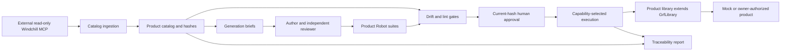

# Architecture

GRF is a product-independent Python core, not a product adapter or MCP server. See
[Repositories](REPOSITORIES.md) for the independent integrations and [Configuration](CONFIGURATION.md)
for how a product selects them.

## Core repository tree

```text
GeneralRobotFramework\
  .github\
    copilot-instructions.md     working and documentation-maintenance rules
    workflows\                  core/reusable Windows and Linux CI
  docs\
    ARCHITECTURE.md              structure and ownership (this guide)
    CONFIGURATION.md            product configuration and external integration
    TESTING.md                  authoring, evidence and validation
    REPOSITORIES.md              repository boundaries and data ownership
  examples\demo\                synthetic product generated from the starter
  src\grf\
    project.py                  TOML configuration and project discovery
    plugin.py                   product extension contract
    cli.py, __main__.py          command orchestration and exit codes
    scaffold.py, templates\      packaged product starter
    capabilities.py, doctor.py  selection and readiness checks
    library.py                  timing, operator and lifecycle helpers
    operator_prompt.py          console/dialog operator interaction
    rigcontrol.py, rig_ssh.py    site protocol and configurable SSH implementation
    pipeline\
      rvs.py, ingest.py          external read-only client, catalog and hashes
      briefs.py                 specification authoring inputs
      drift.py, lint.py          traceability, review and Robot authoring gates
      mutation.py               mock fault orchestration
      report.py                 Robot result/catalog join and evidence reporting
  tests\                        isolated unit, contract and starter end-to-end tests
  README.md                     entry point, installation and guide index
  CONTRIBUTING.md, CHANGELOG.md  change/release policy and history
  pyproject.toml                package, dependency and tooling definitions
  results\, .venv\, dist\        ignored local validation/build artifacts
```

Completed monorepo-split scripts and contradictory migration plans have been removed from the active tree.
Their historical versions remain in Git history. Product services, catalogs and suites must not return to core.

## Product tree

The starter keeps each responsibility separate:

```text
MyProductAutomation\
  grf.toml                         core configuration and plugin reference
  pyproject.toml                    adapter package and approved GRF dependency
  src\product_automation\
    ProductLibrary.py              observable product keywords
    plugin.py                      product commands and catalog/doctor extensions
  catalog\
    demo.scope.toml                 specification selection and area assignment
    brief-rules.md                  product authoring constraints
    reviews.toml                   human/agent review ledger
    mutants.toml                   product-supported mock faults
  fixtures\rvs.json                 synthetic input; remove for real ingestion
  robot\
    environments\mock.py            tier variables
    suites\demo\counter.robot       specification-traced tests
  .github\agents\                   author and independent reviewer instructions
  generated\briefs\, results\       generated inputs and execution output
```

Larger products may add `robot\resources` for shared user keywords and group suites by specification area,
not by execution tier. Declare capabilities on the tests; the selected tier determines which can run.
Python setup/teardown, connection ownership, state reset, observable assertions and fault implementations
belong to the product library. A product must isolate its own resources before declaring a tier parallel-safe.

## Data and execution flow



`ProductPlugin` offers only actual extension points: known message names, extra brief sections, a doctor class
and additional CLI commands. Static names, paths, tiers, capabilities and lint rules belong in `grf.toml`.
Core never imports a named product package. Products may import `grf`; the reverse dependency is forbidden.

The CLI owns tier metadata and result paths, and forwards the selected project root to Robot workers.
The report joins suite-qualified test identities so identical test names in different child suites do not
hide missing execution. See [Testing](TESTING.md) for the distinction between PASS and VERIFIED.
