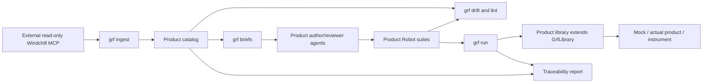

# GeneralRobotFramework architecture

GeneralRobotFramework is the reusable Python core. Product adapters live in separate repositories:
[SMMAutomationFramework](https://github.com/ionut2026/SMMAutomationFramework) and
[WindchillMcpServer](https://github.com/ionut2026/WindchillMcpServer).
See [repository layout and cutover notes](REPOSITORIES.md).

## Boundaries

| Component | Responsibility |
|---|---|
| `src/grf/project.py` | Names, paths, tiers, rules and plugin loading from each product's `grf.toml` |
| `src/grf/plugin.py` | Optional product hooks: known messages, brief sections, doctor and extra commands |
| `src/grf/pipeline/` | Catalog ingestion/hashing, briefs, drift, lint, human review ledger, reports, mutation orchestration |
| `src/grf/library.py` | Timing assertions, operator actions, rig helper and per-test mark/segment bookkeeping |
| `src/grf/capabilities.py` | Capability-based exclusion of explicitly tagged tests |
| `src/grf/doctor.py` | Approved core version, generic prerequisites and optional product-specific checks |
| `src/grf/rigcontrol.py`, `rig_ssh.py` | Site-program protocol and configurable SSH restart/log/clock operations |
| `src/grf/scaffold.py`, `templates/` | Packaged `grf init` product starter and generic author/reviewer agents |
| `examples/demo/` | Synthetic counter adapter and fake RV&S fixture: second consumer, not product evidence |

Core never imports SMM. SMM owns its TypeScript HTTP service, ICD/COP knowledge, SmartInspect parser, state model,
Robot keywords and suites. The external MCP repository owns Windchill's Java API bridge and tool implementation.
Core talks to MCP over stdio; use `WINDCHILL_MCP_SERVER` to select its installed entry point.

## Trust and compatibility

Specification text is the oracle. Tests carry specification IDs and normalized-text hashes; requirements, stories
and explorative-test links come from the catalog. Drift detects changed text, state, links and missing coverage.
Agent review is informational; only current-hash human approval permits removal of `review:pending`.
Mock tiers are `evidence = false` and their reports are not product evidence.
The CLI supplies root-tier metadata so child suites cannot accidentally make mock verdicts appear real.

GRF follows SemVer. Products pin an approved Git tag and exact `[framework] version`; doctor rejects an installed
version mismatch. Local editable installs support coordinated development but are not source-provenance guarantees.
Compatibility shims in the SMM repository preserve historical `smm_automation` generic imports.

CI checks the generic package independently on Windows/Linux, then installs its wheel and runs a generated product.
Product CI checks SMM separately using the pinned core release. Offline/rig execution remains an owner-authorized
product activity, not a generic CI prerequisite. No RV&S publishing or long-term result/history subsystem is added.
