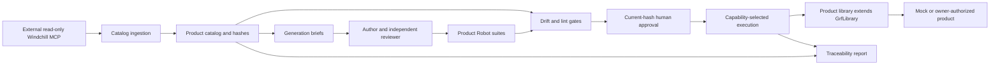

# Architecture

For definitions of a suite, keyword, library and tier, start with [Getting started](GETTING-STARTED.md).
This guide describes how the pieces fit together rather than teaching test syntax.
For a plain-language example of how GRF contributes to SMM and future products, see
[the beginner guide's purpose and reuse explanation](GETTING-STARTED.md#why-does-this-framework-exist).

GRF is a product-independent Python core, not a product adapter or MCP server. See
[Repositories](REPOSITORIES.md) for the independent integrations and [Configuration](CONFIGURATION.md)
for how a product selects them.

## Core repository tree

```text
GeneralRobotFramework\
  .github\
    copilot-instructions.md     working and documentation-maintenance rules
    agents\integration-coordinator.agent.md  opt-in cross-repository coordination role
    skills\                     Copilot task procedures for GRF and generic product work
    workflows\                  core/reusable Windows and Linux CI
  docs\
    GETTING-STARTED.md           beginner concepts and first-run walkthrough
    ARCHITECTURE.md              structure and ownership (this guide)
    CONFIGURATION.md            product configuration and external integration
    TESTING.md                  authoring, evidence and validation
    SKILLS.md                   Copilot skill usage and maintenance
    REPOSITORIES.md              repository boundaries and data ownership
    DEPLOYMENT.md               deploying Jenkins builds to instrument boards
    WORKFLOWS.md                run requests, acceptance, review fingerprints and reservation limits
  examples\demo\                synthetic product generated from the starter
  scripts\setup.ps1             explicit Windows dependency/environment setup after cloning
  src\grf\
    project.py                  TOML configuration and project discovery
    plugin.py                   product extension contract
    commands.py                 public command-local path/catalog/suite services for plugins
    cli.py, __main__.py          command orchestration and exit codes
    scaffold.py, templates\      packaged product starter
    capabilities.py, doctor.py  selection and readiness checks
    library.py                  timing, operator and lifecycle helpers
    acceptance.py               strict local requests and post-run acceptance evaluation
    reservation.py              OS file locks for runs sharing a results root
    deadline.py, process.py      monotonic budgets and owned local subprocess trees
    operator_prompt.py          console/dialog operator interaction
    rigcontrol.py, rig_ssh.py    site protocol and configurable SSH implementation
    pipeline\
      rvs.py, ingest.py          external read-only client, catalog and hashes
      briefs.py                 specification authoring inputs
      drift.py, lint.py          traceability, review and Robot authoring gates
      fingerprint.py            reviewed test and transitive Robot resource content
      mutation.py               mock fault orchestration
      report.py                 Robot result/catalog join and evidence reporting
    deploy\                     generic build deployment (docs\DEPLOYMENT.md)
      model.py, config.py        components/recipes, outcomes, site config validation
      jenkins.py                build resolution and verified download
      transport.py, docker.py    SSH (paramiko/OpenSSH), docker commands and drift
      engine.py, lock.py         deployment steps, rollback, board lock/hold
      record.py, checks.py, cli.py  deployment record, doctor --deploy, `deploy` command
      binding.py                opt-in local record/observed-version diagnostic assertion
  tests\                        isolated unit, contract and starter end-to-end tests
  README.md                     entry point, installation and guide index
  CONTRIBUTING.md, CHANGELOG.md  change/release policy and history
  pyproject.toml                package, dependency and tooling definitions
  results\, .venv\, dist\        ignored local validation/build artifacts
```

Completed monorepo-split scripts and contradictory migration plans have been removed from the active tree.
Their historical versions remain in Git history. Product services, catalogs and suites must not return to core.

## Product tree

The starter keeps each responsibility separate:

```text
MyProductAutomation\
  grf.toml                         core configuration and plugin reference
  pyproject.toml                    adapter package and approved GRF dependency
  src\product_automation\
    ProductLibrary.py              observable product keywords
    plugin.py                      product commands and catalog/doctor extensions
  catalog\
    demo.scope.toml                 specification selection and area assignment
    brief-rules.md                  product authoring constraints
    reviews.toml                   human/agent review ledger
    mutants.toml                   product-supported mock faults
  fixtures\rvs.json                 synthetic input; remove for real ingestion
  jenkins\Jenkinsfile.deploy        optional (--with-deploy): deployment job template
  robot\environments\deploy.example.toml  optional: site config example, copied outside the repo
  robot\
    environments\mock.py            tier variables
    suites\demo\counter.robot       specification-traced tests
  .github\agents\                   author, independent reviewer and integration coordinator instructions
  .github\skills\                   generic Copilot procedures copied from GRF
  generated\briefs\, results\       generated inputs and execution output
```

Larger products may add `robot\resources` for shared user keywords and group suites by specification area,
not by execution tier. Declare capabilities on the tests; the selected tier determines which can run.
Python setup/teardown, connection ownership, state reset, observable assertions and fault implementations
belong to the product library. A product must isolate its own resources before declaring a tier parallel-safe.

## Data and execution flow



`ProductPlugin` offers only actual extension points: known message names, extra brief sections, a doctor class,
additional CLI commands, deployable components (`deploy_components`, see [Deploying builds](DEPLOYMENT.md)),
and split build/runtime identity policy (`runtime_identity`, `installed_matches`, `runtime_matches`,
see [Workflows](WORKFLOWS.md)). Plugin command services and scoped discovery are public contracts;
see [Configuration](CONFIGURATION.md#plugins-and-libraries), not private CLI helpers.
Static names, paths, tiers, capabilities and lint rules belong in `grf.toml`.
Core never imports a named product package. Products may import `grf`; the reverse dependency is forbidden.

Agent templates are starter files, not runtime orchestration: GRF generates briefs but does not automatically
draft product tests or invoke a chain of author/reviewer agents. Existing product agent instructions are
maintained in the product repository and are not overwritten by a GRF package upgrade. See
[the beginner explanation of agents](GETTING-STARTED.md#why-are-agent-files-in-both-repositories).
Starter skills follow the same copy-and-review update model; see [Copilot skills](SKILLS.md).
The opt-in integration coordinator uses the shared `grf-coordinate-integration` procedure, not a GRF runtime
service. Client capabilities determine whether project/session delegation is available; instructions cannot
create tools, reconnect sessions or grant authorization. Framework/consumer owners agree contracts first,
validate consumers against immutable framework commits and sequence authorized releases separately.
See [coordinated integration](SKILLS.md#coordinated-integration).

The CLI owns tier metadata and result paths, and forwards the selected project root to Robot workers.
The report joins suite-qualified test identities so identical test names in different child suites do not
hide missing execution. See [Testing](TESTING.md) for the distinction between PASS and VERIFIED.

A protected product controller validates the request before product actions, holds the authoritative instrument
reservation, then calls deploy/run/gate. GRF's gate evaluates supplied local artifacts after execution and writes
`acceptance.json`; it is not an authenticated approval service or distributed workflow controller.
Local tier locks cover only runs using the same configured results root. A product depends on GRF;
GRF never imports product-specific identity code. See [workflow boundaries](WORKFLOWS.md#supported-boundary).
