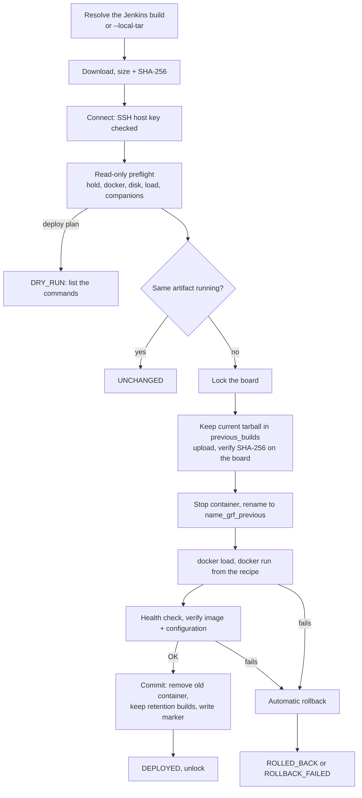

# Deploying builds to instrument boards

New to this? Read [What does deploying a build mean?](GETTING-STARTED.md#what-does-deploying-a-build-mean) first.
This is the reference guide for `<cli> deploy` (`grf deploy` in GRF and the starter, `smm-auto deploy` in SMM).

**Deploying changes the instrument.** A real `deploy run` or `deploy rollback` needs the instrument owner's
authorization. In Jenkins, *starting the authorized deployment job is that authorization* (only the instrument
owners get the job's "Build" permission). Copilot agents and skills never start a deployment; they may explain,
plan (`deploy plan`), read status and help read the record.

## Concepts

| Term | Meaning |
|---|---|
| Component | One deployable application of a product, for example SMM's `appsmm` or `sti`. The product defines it in Python (`ProductPlugin.deploy_components()`). |
| Artifact | The image tarball (`*.tar.gz`, the output of `docker save`) a Jenkins build produced. |
| Target / board | The computer on the instrument the component runs on (an ARM board reached over SSH). |
| Recipe | The exact `docker run` settings of a component (`ContainerRecipe`): image, container name, network, mounts... |
| Site config | A TOML file **outside every repository** naming the Jenkins server, the boards and how to log in. |
| Record | `deployment.json`: who deployed which build where, with checksum, every step and the outcome. |

Who owns what:

| Part | Lives in |
|---|---|
| The deployment steps, rollback, lock, CLI, record, report section | GRF (`src\grf\deploy`) |
| Which components exist, their Jenkins jobs, file patterns, recipes and health checks | The product (SMM: its plugin) |
| Jenkins URL, board addresses, users, credential names, `known_hosts` | The site config on the Jenkins agent |
| Passwords and tokens | Jenkins credentials (or a file outside the repositories); never in a repository |

## How a deployment works

Lock initialization, stale takeover and release are serialized by a short-lived
`.grf-deploy.lock.guard` directory. Release checks the operation's owner token. Missing
or unreadable timestamps/tokens are not evidence of a stale lock: `--break-stale-lock`
never breaks initializing or legacy locks. An abandoned guard or incomplete lock
requires board-owner inspection and manual recovery, not another automated takeover.
Do not mix old and new GRF lock implementations on the same board during migration.

The installed version is derived from the image actually loaded on the board, never merely
from its tarball filename. A filename/image-tag disagreement fails and restores the previous
container rather than recording fabricated installed identity.



Step by step, for one component on one board:

1. **Resolve** the build: `--build N` or `lastSuccessfulBuild` of the component's Jenkins job (or the branch job
   `--branch B` / `[deploy] default_branch`). Only builds with result `SUCCESS` are used, and exactly one artifact
   of the build must match the component's file pattern. `--local-tar F` deploys a local file instead (recorded
   as `source = local`).
2. **Download** to the output folder, checking the size and computing the SHA-256. Nothing on the board has
   changed yet; problems end with `ARTIFACT_FAILED`.
3. **Connect** over SSH; the board's host key is checked against `known_hosts`.
4. **Preflight** (read-only): the hold file, `docker version`, free disk space in the workdir (`min_free_mb` plus
   the artifact size), 1-minute load (`max_load`), companion containers (`requires_containers`: a missing one is
   only a warning, GRF never starts or changes it), a leftover `<name>_grf_previous` container from an unfinished
   deployment (stops the deployment), and what runs now. Problems end with `PREFLIGHT_FAILED` or `HELD`.
5. `deploy plan` **stops here** with `DRY_RUN` and lists the board commands a real run would execute.
6. **Unchanged?** If the container runs the same tarball (SHA-256 and image ID from GRF's board marker) with the
   recipe's configuration, the result is `UNCHANGED` and nothing is restarted. `--force` deploys anyway.
7. **Lock** the board (see [Lock and hold](#lock-and-hold)).
8. **Keep the current tarball**: moved to `<workdir>/previous_builds/`. **Upload** the new one as `<file>.partial`,
   run `sha256sum` on the board, compare, then rename it. A mismatch or upload failure puts the files back and
   ends with `FAILED`: the running container was never touched.
9. **Stop** the running container (`docker stop -t <stop_timeout_s>`) and rename it `<name>_grf_previous`. This
   renamed container is the rollback point.
10. **Load** the image (`docker load -i`); the loaded image must belong to the recipe's repository.
11. **Run** the new container with exactly the recipe's settings.
12. **Health check**: the container runs, does not restart, and stays up for `stable_s` seconds; then the
    component's `health_command` and/or `health_port` must succeed within `ready_timeout_s`.
13. **Verify**: the container runs the loaded image ID, and its configuration (network, privileged, init, restart
    policy, log options, mounts, environment) equals the recipe. A difference fails the deployment (or is a
    warning with `drift = "warn"` on the component).
14. **Commit**: write the board marker `<workdir>/.grf-deploy/<name>.json`, remove `<name>_grf_previous`, keep the
    newest `retention` earlier images and tarballs, `docker image prune -f` (only dangling images). Problems here
    are warnings: the new build already runs.
15. **Unlock**, write the record.

### Automatic rollback

A failure in steps 9-13, Ctrl+C, or a Jenkins abort (SIGTERM) rolls back automatically: remove the new
container, rename `<name>_grf_previous` back, `docker start` it, health-check it, and put the tarballs back.
The result is `ROLLED_BACK` (exit code 5): the previous build runs again, and the record says why the new one
failed.

If rollback is impossible (there was no previous container, or a rollback step fails) the result is
`ROLLBACK_FAILED` (exit code 6) with the message "the instrument needs manual attention". The record's
`recovery` list contains the exact commands for the board owner. GRF never retries on its own.

### Restoring an earlier build

`deploy rollback --component C` redeploys the newest tarball in `<workdir>/previous_builds` through the same
steps (outcome `RESTORED`). It needs no Jenkins access. The site config's `retention` (default 2) decides how many
earlier builds are kept.

## CLI

All commands read the site config from `--config <file>` or `<ENV_PREFIX>_DEPLOY_CONFIG` (`GRF_DEPLOY_CONFIG` in
GRF and the starter, `SMM_DEPLOY_CONFIG` in SMM).

| Command | Changes the board? | What it does |
|---|---|---|
| `deploy components` | no | The product's components, their jobs, patterns, images and configured target |
| `deploy builds --component C [--branch B] [--branches] [--limit N]` | no (Jenkins only) | Recent builds, or the branches of a multibranch job |
| `deploy plan --component C [--build N \| --local-tar F] [--branch B] [--target T]` | no (logs in) | Dry run: resolve, download, preflight, list the commands |
| `deploy status [--component C] [--target T] [--json]` | no (logs in) | What runs, version, drift, hold, lock, retained builds |
| `deploy run --component C[,C2] [build options] [--yes] [--force] [--trigger manual\|nightly] [--ignore-hold] [--break-stale-lock] [--outdir D]` | **yes** | Deploy |
| `deploy rollback --component C [--target T] [--yes]` | **yes** | Back to the newest retained earlier build |

- `run` and `rollback` ask you to type the target name on an interactive terminal; without a terminal they refuse
  unless `--yes` is given. Jenkins passes `--yes`.
- Several components (`--component sti,appsmm`) are deployed in the product's `[deploy] order`; the first failure
  stops the rest. `--build N` and `--local-tar` need a single component.
- `--outdir` (default `results\deploy\<UTC time>-<component>`) receives the downloaded artifact, `deployment.json`
  and `deploy.log`. With several components each gets a subfolder.
- `--trigger` is recorded only (`cli` by default; the Jenkins template passes `manual` or `nightly`).
- `plan` and `run` accept `--sha256 <64 lowercase hex characters>` for one component, including `--local-tar`.
  GRF compares the downloaded/local bytes' digest **before connecting to a board**. Mismatch returns
  `ARTIFACT_FAILED` (4); malformed CLI input returns 2. Resolve `lastSuccessfulBuild` once during planning,
  retain its `artifact.build_number` and `artifact.sha256`, then execute the numeric build with that digest.
  A new upstream build or changed artifact cannot silently replace the approved selection.

Example of a successful dry run:

```text
== plan app -> board-1 (root@10.0.0.1)
[OK] resolve and download the artifact: app_linux-arm_1.2.3.tar.gz (123456789 bytes, sha256 3f2a...), Jenkins build 42
[OK] connect to board-1 (root@10.0.0.1)
[OK] preflight (read-only): ...
  would run: docker stop -t 30 app
  would run: docker rename app app_grf_previous
  ...

DRY_RUN: dry run: nothing was changed on the board
  artifact: app_linux-arm_1.2.3.tar.gz sha256 3f2a... (Jenkins build 42: https://<jenkins-host>/jenkins/...)
Deployment record: results\deploy\20261101T020000Z-app\deployment.json
```

### Outcomes and exit codes

| Outcome | Exit | Meaning | The board |
|---|---|---|---|
| `DEPLOYED` | 0 | The new build runs and passed every check | changed |
| `UNCHANGED` | 0 | That artifact already ran | untouched |
| `DRY_RUN` | 0 | `deploy plan` | untouched |
| `RESTORED` | 0 | `deploy rollback` succeeded | changed |
| (usage/config error) | 2 | Bad option, unknown component, missing or invalid site config, confirmation refused | untouched |
| `PREFLIGHT_FAILED` / `FAILED` | 3 | Board not ready, SSH failure, upload/checksum failure | untouched (container) |
| `ARTIFACT_FAILED` | 4 | Build not SUCCESS, no/several matching artifacts, download failed | untouched |
| `ROLLED_BACK` | 5 | New build failed; the previous one runs again | as before |
| `ROLLBACK_FAILED` | 6 | **Manual attention needed**; see `recovery` in the record | unknown |
| `LOCKED` | 7 | Someone else is deploying to this board | untouched |
| `HELD` | 8 | The owner's hold file is on the board | untouched |

## Configuration

### Site config (outside the repositories)

`grf init --with-deploy` creates `robot\environments\deploy.example.toml` with placeholders only. Copy it outside
the repository (for example on the Jenkins agent), fill it in, and point to it with `<ENV_PREFIX>_DEPLOY_CONFIG`.

```toml
schema = 1

[jenkins]
base_url = "https://<jenkins-host>/jenkins"   # https required (http only for localhost)
# ca_bundle = "<company CA bundle (PEM)>"     # for an internal certificate authority
# insecure_tls = true                         # explicit opt-in, printed and recorded; avoid
user_env = "JENKINS_USER"                     # names of environment variables, not values
token_env = "JENKINS_TOKEN"

[targets.board-1]
host = "<board IP>"
user = "<board user>"
password_env = "BOARD_1_PASSWORD"   # or password_file = "<file outside the repo>" or identity = "<key>"
known_hosts = "<file outside the repo>"
host_key_policy = "accept-new"      # or "pinned"
workdir = "/home/root"
# client = "openssh"                # system ssh/scp, keys only; default "paramiko" (password or key)

[components]
app = "board-1"

[limits]
min_free_mb = 1500
max_load = 5.0
retention = 2
lock_ttl_s = 7200

# audit_log = "<file outside the repo>/deployments.jsonl"
```

Validation refuses: keys named `password`, `token`, `secret` or `passphrase` anywhere; leftover `<placeholders>`;
`password_file`, `identity` or `known_hosts` inside the product repository; plain `http` Jenkins URLs; a workdir
with spaces or shell characters; a password (`password_env`/`password_file`) with `client = "openssh"`; both `password_env` and `password_file`; components naming unknown targets.

Logging in to Jenkins is optional: without `JENKINS_USER`/`JENKINS_TOKEN` GRF reads anonymously. The default
`paramiko` SSH client needs the optional extra: `pip install "general-robot-framework[deploy]"`.

### Product configuration

The product's `grf.toml` may contain (no hosts, no credentials):

```toml
[deploy]
order = ["sti", "appsmm"]   # deployment order when several components are deployed together
default_branch = "master"   # branch job of a multibranch Jenkins job, used when --branch is not given
```

### Environment variables

| Variable | Set by | Purpose |
|---|---|---|
| `<ENV_PREFIX>_DEPLOY_CONFIG` | Jenkins job / person | Path of the site config |
| `JENKINS_USER`, `JENKINS_TOKEN` (names configurable) | Jenkins `withCredentials` | Optional Jenkins API login |
| the target's `password_env` | Jenkins `withCredentials` | Board password; never printed (output is redacted) |
| `GRF_DEPLOYMENT_RECORD` | Jenkins job | Records for `run`/`report` (several separated by `;` on Windows, `:` on Linux) |
| `BUILD_USER_ID`, `BUILD_URL`, `NODE_NAME` | Jenkins | Recorded as who/where |

## Lock and hold

- **Lock** `<workdir>/.grf-deploy.lock`: taken atomically (`mkdir`) before anything changes, with `owner.json`
  (user, Jenkins run, component, start). Another deployment gets `LOCKED` and waits for nothing. The lock is always
  released, also after a failure. A lock older than `lock_ttl_s` is reported as stale; only
  `--break-stale-lock` removes it, after you checked that no deployment runs.
- **Hold** `<workdir>/.grf-deploy.hold`: the owner's "do not deploy" switch, for example during calibration.
  On the board: `echo "calibration until Friday" > /home/root/.grf-deploy.hold`; remove the file to allow
  deployments again. Every deployment ends with `HELD`; a manual run may pass `--ignore-hold`. The nightly job
  never does.

The board lock only protects the deployment itself. Use the Jenkins Lockable Resources plugin
(`lock(resource: '<instrument>')`) around deployment *and* tests so nothing else uses the instrument meanwhile.

## The deployment record and the test report

`deployment.json` (schema 1) contains: project, component, target and host, trigger, start/finish, outcome and
message, artifact (`file_name`, `version`, `size`, `sha256`, `source`, Jenkins `job_url`, `branch`,
`build_number`, `build_url`, `build_result`, `build_timestamp`, git `revision`), `previous` and `installed`
(container, image, image ID, version), every step with status and duration, `drift`, `planned` (dry run),
`recovery` (after `ROLLBACK_FAILED`), `actor` (user, Jenkins run) and the GRF version. `deploy.log` next to it is
the readable log. With `audit_log` the same JSON is appended as one line to the site audit file.

Show the deployed builds in the test report:

```powershell
grf run --tier <tier> --deployment results\deploy        # a folder: every deployment.json in it
grf report --outdir <run folder> --deployment results\deploy\20261101T020000Z-app\deployment.json
```

The HTML report then has a **Deployed builds** table (component, target, version, branch/build, file and SHA-256,
outcome, time) and the JSON report a `deployments` list. An outcome other than `DEPLOYED`/`UNCHANGED` is shown as a
warning: the tests may not have run against the intended build. A deployment never changes the evidence rules;
see [Testing](TESTING.md).

### Checking the observed product version

`--deployment` and `GRF_DEPLOYMENT_RECORD` attach provenance only. They do not expose a Robot variable,
query a product version, select a record for assertions or automatically add setup checks.
An adapter that extends `grf.library.GrfLibrary` inherits this opt-in keyword:

```text
Deployment Record Should Match Product Version    record    component    actual_version    target    project=
```

`record` must name one existing JSON file, not a directory or an inferred latest deployment.
`component`, `actual_version` and `target` must be nonempty strings. The optional `project` defaults to the
current `grf.toml` display name. Comparisons are exact, case-sensitive strings, with no version normalization.
The keyword returns the parsed record on success and fails the test with a diagnostic otherwise.
The underlying Python API is:

```python
from grf.deploy.binding import assert_product_version

record = assert_product_version(
    record_path, "app", observed_version, target="board-1", project="My Product",
)
```

Signature: `assert_product_version(record: str | Path, component: str, actual_version: str, *,
target: str, project: str | None = None) -> dict[str, Any]`.
The Python helper raises `AssertionError`; `project=None` omits only the expected-project comparison.
Product integrations should supply their project name explicitly. Both entry points require a schema-1
record, nonempty project/component/target fields, `dryRun=false`, a `DEPLOYED`, `UNCHANGED` or `RESTORED` outcome,
and `installed.status="running"` with a nonempty `installed.version`. They compare **installed.version**,
never the requested artifact version: failed/rolled-back deployments, dry runs and missing observations
cannot become successful bindings. `RESTORED` is accepted by this assertion even though the report's
provenance table conservatively warns for outcomes other than `DEPLOYED`/`UNCHANGED`.

Example product-owned setup (illustrative only; `Read Fresh Product Version` must be implemented by the
product adapter):

```robotframework
*** Keywords ***
Check Selected Deployment
    ${observed}=    Read Fresh Product Version
    Deployment Record Should Match Product Version    ${DEPLOYMENT_RECORD}    app    ${observed}    ${DEPLOYMENT_TARGET}
```

From the consuming product's root, on an **owner-authorized** tier, explicitly supply both the report attachment
and the Robot variable when invoking a suite that calls this setup:

```powershell
grf run --tier <authorized-tier> --outdir results\version-check --deployment <record-file> --variable DEPLOYMENT_RECORD:<record-file> --variable DEPLOYMENT_TARGET:board-1
```

Successful output includes a passing setup assertion; any mismatch fails the test. No new configuration keys
are needed, and existing suites remain unchanged until they call the keyword. The helper reads only the local
file, needs no `deploy` extra, and performs no deployment or network operation.

The product must freshly observe its version, reject missing/malformed responses, and establish the mapping
between the observed endpoint and the expected target. `target` checks a record label, **not physical board
identity**. Version equality alone does not prove artifact identity, record freshness, absence of another
deployment, or correct behavior. Coordinate deployment and tests with the owner's instrument lock and retain
the record with the results. Synthetic/mock checks are never product evidence.

## Jenkins

### Gate after deploy

A protected owner-controlled runner validates the request **before** any deployment, binds it to exact
source/catalog/build/digest/selection and target policy, and holds one authoritative instrument reservation
through deployment, tests and acceptance. After success, `grf gate --request <file> --output <run>\output.xml
--deployment <record>` checks the completed run. A failing deployment stops tests; a test/gate failure must not
be hidden by successful report generation. No automatic rollback is performed merely because a test fails.
See [request schema, exit codes and limits](WORKFLOWS.md).

Attaching `--deployment` is informational; the gate is the single acceptance policy. The inherited Robot version
keyword is an optional diagnostic assertion, not a replacement. These APIs do not authenticate approval or prove
physical board identity. Product commissioning must establish endpoint mapping, controller policy and recovery.

`grf init --with-deploy` also creates `jenkins\Jenkinsfile.deploy`, a commented template:

- parameters `COMPONENTS`, `BUILD`, `BRANCH`, `PLAN_ONLY`, `RUN_TESTS`, `TIER`;
- schedules/downstream triggers left disabled until the owner/admin commissions bounded authorization;
- `disableConcurrentBuilds()`, a timeout, and a commented `lock(...)` for the Lockable Resources plugin;
- `withCredentials` for the Jenkins token and the board password;
- validation of a supplied protected request against the exact single component/numeric build/digest/tier;
- `grf deploy run --yes ... --sha256 ... --outdir results/deploy`, then `grf run --deployment results/deploy`;
- `grf gate` after successful tests, archiving `acceptance.json`, `deployment.json`, `deploy.log` and reports.

This starter is not a production controller: add protected approval/source/catalog/target binding and approved
selection filters before enabling it. Acceptance requires the Pipeline Utility Steps plugin (`readJSON`).
Failed Robot execution already fails the job and skips the later gate; use a product-owned finalization policy
if the site must write rejection records even after test failure. Never catch a failure to turn the job green.

Prerequisites, done by the site's Jenkins administrator and the instrument owner (never by an agent):

1. A Jenkins agent on the instrument's network with Python 3.11+, the product installed with GRF's `deploy` extra.
2. The job created from the template, with "Build" permission only for the instrument owners.
3. Credentials: the board password (and optionally a Jenkins API token) as Jenkins credentials.
4. The filled-in site config and the `known_hosts` file on the agent, outside the workspace.
5. First authorized runs: `PLAN_ONLY`, then a real deployment of the build that already runs (expect
   `UNCHANGED`), then a different build, then a deliberate `deploy rollback`, then enable the nightly run.

## Security

| Risk | Control |
|---|---|
| Unauthorized deployment | Job permission restricted to owners; confirmation on a terminal; actor recorded; agents never deploy |
| Leaked secrets | Passwords only in Jenkins credentials or files outside repositories; secret keys rejected in configs; all board output redacted |
| Man in the middle | Jenkins TLS verified (`ca_bundle`); SSH host keys checked: `accept-new` stores a new board's key and refuses a **changed** key, `pinned` refuses unknown boards; redirects must stay on the Jenkins host |
| Wrong or corrupt build | `SUCCESS` builds only, exactly one matching artifact, SHA-256 checked locally and on the board, loaded image repository checked |
| Two deployments at once | Board lock, `disableConcurrentBuilds`, Lockable Resources |
| Instrument left broken | Automatic rollback, `ROLLBACK_FAILED` escalation with recovery commands, retained builds, `deploy rollback` |
| Data loss on the board | No `docker image prune -a`; only the component's own container and images are removed; mounted folders are never deleted |

Never commit a password, a filled-in site config or `known_hosts`, never disable host-key checking, and do not set
`insecure_tls` without a recorded reason.

## Troubleshooting

| Message | What to do |
|---|---|
| `no deployment config: pass --config <file> or set ..._DEPLOY_CONFIG` | Set the variable to the site config outside the repository |
| `... must be set (replace the <placeholder>)` | The site config still contains example values |
| `the environment variable X (password_env) is not set` | Run inside Jenkins `withCredentials`, or set it in your shell |
| `the paramiko ssh client is not installed` | `pip install "general-robot-framework[deploy]"` |
| `TLS certificate of ... not trusted` | Set `[jenkins] ca_bundle` to the company CA bundle |
| `the host key of ... CHANGED` | Stop. Ask the owner whether the board was replaced; only then remove its old line from `known_hosts` |
| `... result is FAILURE, only SUCCESS builds are deployed` | Choose another build (`deploy builds`) |
| `0 artifacts match` / `2 artifacts match` | The job's artifacts changed; the product's file pattern needs review |
| `only N MB free` / `board load ... is above` | Free space on the board or try later; nothing was changed |
| `container X_grf_previous exists` | An earlier deployment did not finish: `deploy status`, then the owner removes or renames it back |
| `LOCKED ... Wait until it finishes` | Another deployment runs; stale lock: check, then `--break-stale-lock` |
| `HELD` | The owner put a hold on the board; ask them |
| `ROLLED_BACK` | The previous build runs; read the failing step in `deploy.log` |
| `ROLLBACK_FAILED` | Tell the instrument owner immediately; follow `recovery` in `deployment.json` |

Check a machine before the first deployment with `grf doctor --deploy` (configuration, credentials *present*,
Jenkins reachable, host keys); `--deep` also logs in to each board and runs `docker version` (read-only).

## Adding a component (product developers)

In the product's plugin:

```python
from grf.deploy.model import Component, ContainerRecipe, Mount
from grf.plugin import ProductPlugin


class MyPlugin(ProductPlugin):
    def deploy_components(self) -> list[Component]:
        return [Component(
            name="app",
            description="the main application",
            jenkins_job="view/MyProduct/job/App",                 # path below the Jenkins base URL
            artifact_pattern=r"^app_linux-arm_.*\.tar\.gz$",      # exactly one artifact must match
            version_from_filename=r"app_linux-arm_(?P<version>[^/]+)\.tar\.gz",  # or None: the image tag
            recipe=ContainerRecipe(image="vendor/app/arm", name="app", restart="unless-stopped",
                                   log_options=(("max-size", "10m"),), mounts=(Mount("/data", "/data"),)),
            requires_containers=("mosquitto",),
            health_port=1883,
        )]
```

Copy the recipe from the settings the instrument uses today (`docker inspect` on the board); `deploy status`
reports any difference as drift. Test recipes with a golden `docker run` string (`grf.deploy.docker.run_command`),
and test file patterns with real-looking file names. GRF's own tests use a simulated board
(`tests\deploy_fakes.py`); passing them says nothing about a real board.
